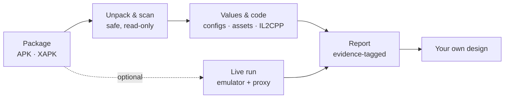

# APK Gameplay Learning

**Learn how mobile games play and earn money from their Android packages, then build your own.**

Open an APK or XAPK and read its gameplay code, art, sounds, levels, ad setup, floors, pacing and offers. Optionally run it on an isolated emulator to see the config its server really sends.

> [!IMPORTANT]
> **Learning only.** Take the pattern, never the game: no code, art, names or numbers go into a product.
> This repository is the toolbox, never a game. Packages and per-game notes live in `~/Desktop/apk-work/<run-id>/`, outside it.

## Pick your goal

| I want to learn… | Start here | First command |
| --- | --- | --- |
| **How a game plays**: mechanics, code, sprites, 3D, sounds, levels | [docs/METHOD.md](docs/METHOD.md) | `python3 toolkit/inspect_package.py <package>` |
| **How a game earns money**: ad stack, floors, pacing, segments, offers | [docs/MONETIZATION.md](docs/MONETIZATION.md) | `python3 toolkit/run_monetization.py <folder> --run <run-id>` |
| **What the server really sends**: live config, A/B tests, per-device floors | [docs/LIVE_CAPTURE.md](docs/LIVE_CAPTURE.md) | an emulator run; one launch is often enough |
| **How to show it to the team**: one page, English and Russian | [toolkit/README.md](toolkit/README.md#comparison-page) | `python3 toolkit/build_monetization_page.py <page.html> <data.json>` |

## How it works



Every claim in a report carries its evidence: **data** (a bundled value), **code**, **names**, **store**, **internal** or **inferred**.

## Quick start: a monetization teardown

Needs Python 3. Tested on macOS (Apple silicon). The optional tools (.NET 10, jadx, UnityPy) add code recovery and script values; `--check` says what is missing.

```sh
python3 toolkit/run_monetization.py --check
python3 toolkit/run_monetization.py "<folder with packages>" --run my-run
```

Then open `~/Desktop/apk-work/my-run/INDEX.md` and each game's `EVIDENCE.md`. Fill [templates/MONETIZATION.md](templates/MONETIZATION.md) per game. The run resumes where it stopped.

## Rules

1. **Learn, never clone.** Build your own game with your own code, art, sound, names and numbers.
2. **No game files here:** no packages, recovered code, exported assets or per-game reports.
3. **Never run recovered code.** A game runs only in a live run the user asked for, on an emulator, with no ad clicks, purchases or hooking.
4. **Mask keys, tokens and ad unit ids** in everything you write. Never defeat protection such as PairIP.

## What's inside

**Method**

| Doc | What it covers |
| --- | --- |
| [METHOD.md](docs/METHOD.md) | Package → engine → assets → code → findings → your own design |
| [MONETIZATION.md](docs/MONETIZATION.md) | Ad stack, floors, pacing, segments and offers, read from the package |
| [LIVE_CAPTURE.md](docs/LIVE_CAPTURE.md) | Emulator run: saved config, traffic and logs |
| [ENGINE_ROUTES.md](docs/ENGINE_ROUTES.md) | Code-recovery routes per engine |
| [WORKFLOW.md](docs/WORKFLOW.md) | Evidence rules for deep code work |
| [LESSONS_LEARNED.md](docs/LESSONS_LEARNED.md) | Pitfalls we hit and how to avoid them |

**Tools** (details in [toolkit/README.md](toolkit/README.md))

| Tool | What it does |
| --- | --- |
| `run_monetization.py` | One command: packages in, an evidence folder per game out |
| `inspect_package.py` | Read-only inventory: hashes, ABIs, engine signals |
| `unpack_package.py` | Safe unpacking: path checks, byte cap, time budget |
| `scan_monetization.py` | Ad, purchase, analytics and protection SDKs with versions, plus searchable strings |
| `export_unity_assets.py` | Unity sprites, textures, audio, meshes, fonts, text and script values |
| `recover_gameplay.py` | Unity Mono and IL2CPP code export (patched Cpp2IL + ILSpy) |
| `build_monetization_page.py` | Comparison page from per-language data files |
| `live/` | Emulator capture: certificate injection, traffic summary, host list, JSON diff |

**Templates:** [mechanic record](templates/MECHANIC.md), [monetization report](templates/MONETIZATION.md), [analyst brief](templates/MONETIZATION_BRIEF.md), [run context](templates/MONETIZATION_CONTEXT.md), [comparison page](templates/MONETIZATION_PAGE.html) with [sample data](templates/MONETIZATION_PAGE_DATA.json). A filled example for a made-up game: [examples/](examples/synthetic-mechanic.md).

## With Claude Code

Claude reads [AGENTS.md](AGENTS.md) through [CLAUDE.md](CLAUDE.md). Ask for a monetization teardown and the `monetization-teardown` skill walks the whole route. A saved multi-agent workflow in `.claude/workflows/` runs one analyst and one reviewer per game, but only when you ask for it.

## Tests

```sh
python3 -m unittest discover -s tests
```

All tests use synthetic data, no game files.
